# 01 · Sitemap Final — RUWAY ACADEMY

**Agente:** A1 (Arquitecto de Información) · Fase 1
**Fecha:** 16 de octubre de 2026
**Versión:** 2.0 (final propuesta)
**Entradas:** `00-inventario-insumos.md` (aprobado) · `01-mapa-del-sitio.md` v1.0 · `ruway-marca/*`

> **Contexto operativo:** dominio `academiaruway.com` · inicio del Ciclo 1 **martes 27 de octubre de 2026**.
> El sitio debe estar **en vivo antes de esa fecha** para captar la convocatoria.

---

## 1. Diagnóstico del mapa actual (`01-mapa-del-sitio.md` v1.0)

### 1.1 Fortalezas (se conservan íntegras)

| # | Acierto | Por qué importa |
| :-- | :--- | :--- |
| 1 | **Embudo explícito**: cada página tiene un único CTA al paso siguiente | Alineado al negocio: cerrar la venta que inicia en redes |
| 2 | **Regla de máximo 3 clics** al formulario | Reduce abandono en tráfico móvil de TikTok/Instagram |
| 3 | **Cero fricción legal**: certificado "sin validez oficial MINEDU" visible sin PDF | Diferenciador de honestidad radical (`SOUL.md`) y requisito de conversión con padres |
| 4 | **Anclas internas** (`#temario`, `#tarifas`, `#devoluciones`) | Permiten deep-links desde redes a una sección exacta |
| 5 | **Mobile-first declarado** | Coherente con el origen del tráfico |
| 6 | **SEO local con NAP consistente** | Sostiene el canal #1 del plan (Google Business Profile) |
| 7 | **Tabla única de precios** | Impide contradicciones de precio entre secciones |

### 1.2 Vacíos detectados (10)

| # | Vacío | Gravedad | Justificación |
| --: | :--- | :--- | :--- |
| 1 | `/cookies` no existe | **Alta** | Exigido por el brief (restricción §5) y por el uso de analítica/OG |
| 2 | `/contacto` no existe como página | **Alta** | Hoy solo vive en el footer. Una URL propia con NAP + mapa + formulario refuerza el SEO local y captura búsquedas de "dónde estudiar IA en Cajamarca" |
| 3 | `/instituciones` no existe | **Alta** | El canal de colegios e institutos (§11.4) se activa en la fase de convocatoria: necesita una landing propia para el taller gratuito |
| 4 | `/gracias` no existe | **Media** | Sin página de confirmación no hay evento de conversión medible ni confirmación accesible para el usuario que envió el formulario |
| 5 | `/demo-day` no existe | **Media** | Es la principal prueba social y el motor del embudo demo→matrícula (§5.3 sem. 8). Pero su contenido no puede existir hasta que ocurra el primer Demo Day |
| 6 | `/nivel-2` no existe | **Media** | El plan prevé preventa del Ciclo 2 (§11.5) con un destino web que hoy no tiene |
| 7 | Página `404` personalizada | **Media** | Accesible, con retorno al embudo; evita pérdida de tráfico por enlaces rotos desde redes |
| 8 | Archivos técnicos (`sitemap.xml`, `robots.txt`, `manifest.webmanifest`) | **Media** | `sitemap.xml` y `robots.txt` están citados en el mapa pero no definidos como artefactos |
| 9 | **Anclas sin nomenclatura normalizada** | **Baja** | El mapa usa `#metodologia` (en `/programa`) y `#metodo` (en `/sobre`). Conviene una convención fija |
| 10 | **Semántica incompleta** | **Baja** | El mapa define `EducationalOrganization` + `Course` + `FAQPage`. Faltan `LocalBusiness`, `BreadcrumbList`, `Offer` y `Event` |

---

## 2. Decisión de arquitectura: el sitio se entrega en **dos olas**

No se crean páginas vacías. Las rutas cuya materia prima **todavía no existe** se planifican
pero se publican cuando tengan contenido real.

| Ola | Cuándo | Criterio |
| :--- | :--- | :--- |
| **Ola 1 — Lanzamiento** | antes del **27/10/2026** | Todo el contenido ya existe en `plan completo.md` |
| **Ola 2 — Post Demo Day** | ~diciembre 2026 | Requiere que ocurra el Ciclo 1 (proyectos, egresados, Nivel 2) |

> **Por qué importa:** publicar `/demo-day` o `/nivel-2` hoy significaría mostrar páginas vacías
> ("próximamente"), lo que contradice la honestidad de marca y perjudica el SEO. Mejor no tenerlas
> que tenerlas a medias.

---

## 3. Diagrama jerárquico de la arquitectura

```mermaid
graph TD
  ROOT(("academiaruway.com"))

  ROOT --> HOME["/ · Inicio"]

  ROOT --> PROG["/programa · Programa"]
  PROG --> P1["#ficha"]
  PROG --> P2["#temario (semana-1 … semana-8)"]
  PROG --> P3["#metodologia"]
  PROG --> P4["#herramientas"]
  PROG --> P5["#evaluacion"]
  PROG --> P6["#certificado"]

  ROOT --> PREC["/precios · Precios"]
  PREC --> PR1["#tarifas"]
  PREC --> PR2["#descuentos"]
  PREC --> PR3["#devoluciones"]

  ROOT --> INSC["/inscripcion · Inscripción y demo"]
  INSC --> IN1["#requisitos"]
  INSC --> IN2["#formulario"]
  INSC --> IN3["#despues"]
  INSC --> GRA["/gracias · Confirmación"]

  ROOT --> FAQ["/preguntas-frecuentes"]

  ROOT --> SOBRE["/sobre · Sobre RUWAY"]
  SOBRE --> S1["#identidad"]
  SOBRE --> S2["#metodo"]
  SOBRE --> S3["#sede"]
  SOBRE --> S4["#equipo"]

  ROOT --> CONT["/contacto"]
  ROOT --> INST["/instituciones"]

  ROOT --> LEGAL["Legal"]
  LEGAL --> L1["/privacidad"]
  LEGAL --> L2["/terminos"]
  LEGAL --> L3["/cookies"]

  ROOT --> E404["/404"]

  ROOT -.-> OLA2{{"OLA 2 · post Demo Day"}}
  OLA2 -.-> DD["/demo-day"]
  OLA2 -.-> N2["/nivel-2"]

  classDef ola2 stroke-dasharray: 5 5
  class DD,N2 ola2
```



---

## 4. Tabla maestra de páginas

### 4.1 Ola 1 — Lanzamiento (13 páginas)

| # | Ruta | Propósito | CTA principal | Palabras clave SEO (es-PE) |
| --: | :--- | :--- | :--- | :--- |
| 1 | `/` | Puerta de entrada y conversión. Explica qué es RUWAY en 10 segundos | **Reserva tu demo gratis** | curso de inteligencia artificial en Cajamarca · academia de IA Cajamarca · aprender IA presencial |
| 2 | `/programa` | Detalle completo: 8 semanas, 24 sesiones, 48 h, temario, metodología, certificado | Reservar demo / Inscribirme | programa de IA aplicada · temario curso de IA · curso de IA 8 semanas |
| 3 | `/precios` | Tabla única de precios + descuentos + devoluciones. Elimina la fricción del "¿cuánto cuesta?" | Inscribirme | precio curso de IA Cajamarca · cuánto cuesta curso de inteligencia artificial |
| 4 | `/inscripcion` | Formulario + requisitos. Segmentado: **clase demo** o **matrícula** | Enviar por WhatsApp | inscripción curso de IA Cajamarca · clase demo gratis IA |
| 5 | `/gracias` | Confirmación accesible + qué sigue + evento de conversión | Volver al inicio / WhatsApp | *noindex* |
| 6 | `/preguntas-frecuentes` | Resuelve objeciones de padres y alumnos (12 preguntas) | Reservar demo | preguntas curso de IA · certificado curso de IA validez |
| 7 | `/sobre` | Identidad ("Ruway" = camino), misión, visión, método, sede y horarios | Reservar demo | academia RUWAY · escuela de IA Cajamarca |
| 8 | `/contacto` | NAP + mapa + formulario + horario de atención (SEO local) | Escribir por WhatsApp | contacto academia de IA Cajamarca · dónde estudiar IA en Cajamarca |
| 9 | `/instituciones` | Landing B2B: taller gratuito de 1 hora para colegios e institutos | Solicitar taller | taller de IA para colegios Cajamarca · charla de IA institutos |
| 10 | `/privacidad` | Ley 29733, finalidad, derechos ARCO, contacto del responsable | *(informativo)* | política de privacidad RUWAY |
| 11 | `/terminos` | Matrícula, IGV, certificado sin validez MINEDU, devoluciones, faltas | *(informativo)* | términos y condiciones RUWAY |
| 12 | `/cookies` | Política de cookies y base legal | *(informativo)* | política de cookies |
| 13 | `/404` | Recuperación accesible con enlaces al embudo | Ver el programa | *noindex* |

**Artefactos técnicos (no son páginas):** `sitemap.xml` · `robots.txt` · `manifest.webmanifest` · `favicon.ico`/`favicon.svg`

### 4.2 Ola 2 — Post Demo Day (2 páginas)

| # | Ruta | Propósito | CTA | Requisito para publicar |
| --: | :--- | :--- | :--- | :--- |
| 14 | `/demo-day` | Prueba social: proyectos de egresados, fotos, fecha del próximo Demo Day | Ver proyectos / Reservar | Que exista el 1.er Demo Day (semana 8) |
| 15 | `/nivel-2` | Preventa del Ciclo 2 ("IA aplicada a negocios y automatización avanzada") + precio alumni −15 % | Reservar plaza Ciclo 2 | Que exista temario de Nivel 2 `[POR DEFINIR]` |

---

## 5. Estructura de la Home (`/`) — detallada

Se conserva la estructura del mapa v1.0, **reenriquecida** con la fecha de inicio confirmada.

| # | Bloque | Contenido | Función |
| --: | :--- | :--- | :--- |
| 1 | **Hero** | Eslogan "Tu camino a la inteligencia artificial, paso a paso" + subcopy (presencial, Cajamarca, sin conocimientos previos) + **badge de inicio: "Próximo inicio: martes 27 de octubre"** + CTA doble: *Reserva tu demo gratis* / *Ver el programa* | Atención + conversión |
| 2 | Barra de datos | 8 semanas · 24 sesiones · 48 h · grupos de 7 a 10 · desde 14 años | Prueba rápida |
| 3 | Propuesta de valor | 4 tarjetas (presencialidad, grupos pequeños, proyectos reales, herramientas vigentes) | Diferenciación vs. cursos online |
| 4 | Para quién | 3 perfiles → proyecto tipo por segmento (`ruway-marca/USER.md`) | Autorreconocimiento |
| 5 | El camino | 4 pasos: Fundamentos → Prompting → Crear y automatizar → Proyecto + Demo Day | Demuestra "paso a paso" |
| 6 | Herramientas | Logos/nombres: ChatGPT · Gemini · Copilot · Make/Zapier · Notion | Vigencia del contenido |
| 7 | Resultado | Perfil del egresado (6 puntos, §5.2) | Promesa concreta |
| 8 | Precio resumido | S/ 550 general · S/ 450 escolar · demo gratis + nota "IGV incluido" | Filtro de precio temprano |
| 9 | Sede | Dirección + enlace a `/contacto` | Confianza (padres) |
| 10 | Bloque de honestidad | "Certificado de participación — sin validez oficial MINEDU" | Transparencia (`SOUL.md`) |
| 11 | **CTA final** | Reserva de demo gratuita (cupo 12) + recordatorio de fecha de inicio | Conversión |

> **Cambio vs. v1.0:** se añaden los bloques 6 (Herramientas), 9 (Sede) y 10 (Honestidad),
> y el badge de fecha en el Hero. Justificación: la fecha **27/10** es el activo de conversión
> más fuerte en esta etapa; y el bloque de honestidad es un diferenciador de marca, no un aviso legal.

---

## 6. Flujos de usuario clave

### 6.1 Flujo A — Alumno escolar/universitario (tráfico de TikTok/Reels)

```
Reel de TikTok/Instagram  →  /  →  /programa (#temario)
                                   ↓
                    se reconoce en "Para quién"
                                   ↓
                        /precios (#tarifas)
                                   ↓
                    /inscripcion?intencion=demo
                                   ↓
                        /gracias  →  WhatsApp +51 930 736 214
                                   ↓
                            Asiste a la DEMO GRATIS
```
**Clics hasta el formulario: 3.** Objetivo declarado: demo → matrícula ≥ 40 %.

### 6.2 Flujo B — Padre/madre que decide la compra

```
Google Maps / búsqueda local  →  /contacto (NAP + mapa + horario)
                                        ↓
                                    /precios
                                        ↓
                                 /preguntas-frecuentes
                            ("¿el certificado vale?", "¿y si falta?")
                                        ↓
                              /inscripcion (#requisitos)
```
**Necesidad cubierta:** dirección física verificable, precio sin sorpresas, devoluciones y honestidad del certificado.

### 6.3 Flujo C — Emprendedor / público general

```
/  →  Bloque "Para quién" (negocio familiar)
        ↓
   /programa (#temario, semana 6: automatización)
        ↓
   /precios → /inscripcion
```

### 6.4 Flujo D — Colegio o instituto (canal B2B)

```
Difusión / referido  →  /instituciones
                            ↓
                  "Solicitar taller gratuito de 1 hora"
                            ↓
                        WhatsApp directo
                            ↓
              Taller intraescolar  →  /inscripcion (alumnos)
```
Canal #3 de captación del plan (§11.1). Justifica la existencia de `/instituciones` en la Ola 1.

### 6.5 Flujo E — Alumni (Ola 2)

```
Egresado del Ciclo 1  →  /nivel-2  →  Reserva con descuento alumni (−15 %)
```

---

## 7. Navegación y footer

### 7.1 Header (navegación principal)

| Orden | Enlace | Nota |
| --: | :--- | :--- |
| 1 | Inicio | — |
| 2 | Programa | — |
| 3 | Precios | — |
| 4 | Preguntas frecuentes | — |
| 5 | Sobre | — |
| — | **[CTA: Reserva tu demo gratis]** | Botón destacado, siempre visible |
| — | **Menú hamburguesa** en móvil | `aria-expanded`, `aria-controls`, foco atrapado |

> **Decisión:** `/contacto` e `/instituciones` **no** van en el header (evitan saturar y diluir el
> CTA). Se accede a ellas desde el footer, desde el cierre del Home y desde enlaces contextuales.

### 7.2 Footer (4 columnas + barra inferior)

| Columna | Enlaces |
| :--- | :--- |
| **Programa** | Programa · Precios · Inscripción · Preguntas frecuentes |
| **Academia** | Sobre RUWAY · Contacto · Instituciones · *(+ /demo-day y /nivel-2 en Ola 2)* |
| **Legal** | Política de privacidad · Términos y condiciones · Política de cookies |
| **Contacto** | WhatsApp `+51 930 736 214` · `ruway.edu.cax@gmail.com` · Jr. Los Geranios 250, Cajamarca · Horario de atención `[POR DEFINIR]` |

**Barra inferior:** © 2026 RUWAY ACADEMIA · Cajamarca, Perú · Aviso destacado:
*"Certificado de participación sin validez oficial MINEDU."* · Redes sociales `[POR DEFINIR]`

**Accesibilidad del footer:** `<footer role="contentinfo">`, listas `<ul>`, todos los enlaces con
texto descriptivo (nada de "clic aquí").

---

## 8. Convención de anclas (normalizada)

| Página | Anclas definitivas |
| :--- | :--- |
| `/programa` | `#ficha` · `#temario` · `#semana-1` … `#semana-8` · `#metodologia` · `#herramientas` · `#evaluacion` · `#certificado` |
| `/precios` | `#tarifas` · `#descuentos` · `#devoluciones` |
| `/inscripcion` | `#requisitos` · `#formulario` · `#despues` |
| `/sobre` | `#identidad` · `#metodo` · `#sede` · `#equipo` |
| `/contacto` | `#mapa` · `#formulario` |

**Regla:** kebab-case, sin acentos, en español. `#metodologia` se mantiene para el programa y
`#metodo` para el enfoque de la academia (conceptos distintos, páginas distintas).
Además: `scroll-margin-top` en todos los encabezados con ancla para que el header fijo no los tape.

---

## 9. Estructura de URLs

- Todo en **minúsculas**, **sin acentos**, **sin guiones bajos**, sin extensión.
- Rutas en **español** (`/programa`, no `/program`) → coherencia con el idioma único y con el SEO local.
- Una sola barra final, sin duplicados (`/programa/` → 301 a `/programa`).
- Parámetros de intención: `/inscripcion?intencion=demo` y `?intencion=matricula` (mismo formulario,
  distinto estado inicial) — **no** se crean dos rutas distintas, para no fragmentar la autoridad SEO.
- Dominio canónico: **`https://academiaruway.com`** (siempre con `www` redirigido a raíz, o al revés,
  pero **una sola** versión canónica).

---

## 10. SEO técnico

### 10.1 Semántica JSON-LD

| Tipo | Dónde | Datos |
| :--- | :--- | :--- |
| `EducationalOrganization` | Global (`<head>` del layout) | `name` "RUWAY ACADEMY", `url` `https://academiaruway.com`, `email`, `telephone` |
| `LocalBusiness` | `/contacto` y `/sobre` | `address` (Jr. Los Geranios 250, Cajamarca), `geo` `[POR DEFINIR]`, `openingHours` `[POR DEFINIR]`, `areaServed` Cajamarca |
| `Course` + `CourseInstance` + `Offer` | `/programa` y `/precios` | `name` "Programa de Inteligencia Artificial Aplicada", `timeRequired` P8W, `offers` S/ 550 y S/ 450, `startDate` 2026-10-27, `maximumAttendeeCapacity` 10 |
| `FAQPage` | `/preguntas-frecuentes` | Las 12 preguntas reales |
| `BreadcrumbList` | Todas las páginas internas | Migas de pan |
| `Event` | `/demo-day` (Ola 2) | Demo Day público |

> ⚠️ **No usar** `Course` con `educationalCredentialAwarded` que sugiera reconocimiento oficial.
> El certificado **no tiene validez oficial MINEDU** (§5.7).

### 10.2 Metadata por página

- Títulos con patrón: `{Página} | Curso de Inteligencia Artificial en Cajamarca · RUWAY ACADEMY`
- `meta description` única por página (140–160 caracteres), orientada a beneficio.
- `canonical` absoluta en todas las páginas.
- `lang="es-PE"` en `<html>`.
- **Open Graph + Twitter Cards** con la imagen `ruway-logo-descriptor-sobre-*` sobre fondo de marca
  (formato 1200×630), para que se vea bien al compartir por WhatsApp y TikTok.
- `robots`: `index, follow` salvo `/gracias` y `/404` → `noindex, follow`.

### 10.3 Archivos técnicos

- `sitemap.xml`: generado automáticamente con `lastmod` y prioridades (Home 1.0, embudo 0.8, legal 0.3).
- `robots.txt`: permite todo excepto `/gracias`; declara la ubicación del sitemap.
- `manifest.webmanifest`: iconos desde `ruway-icono-app-1024.png` y favicons (ya disponibles).

### 10.4 Mediciones (alineadas a §3.4 y §11.2)

| Evento | Qué mide | Meta del plan |
| :--- | :--- | :--- |
| Clic en CTA de demo | Intención | — |
| Envío de formulario → `/gracias` | Leads | ≥ 10/semana |
| Clic en WhatsApp | Contacto directo | — |
| Descarga/lectura de `/precios` | Interés real | — |

> Trazabilidad de campañas: los enlaces de TikTok/Reels e Instagram llegan con UTM
> (`?utm_source=tiktok&utm_medium=social&utm_campaign=ciclo1-2026`) para atribuir los leads.

---

## 11. Confirmación de reglas de accesibilidad de la arquitectura

| Regla | Cómo se respeta en el sitemap |
| :--- | :--- |
| Máximo 3 clics al formulario | Verificado en los 5 flujos (§6) |
| Legal sin descargar PDF | Privacidad, Términos y Cookies son **páginas HTML** |
| Un solo CTA principal por página | Definido en la tabla §4 |
| Sin páginas vacías | Roadmap en dos olas (§2) |
| Toda página tiene retorno al embudo | Incluido en `404` y `/gracias` |
| Anclas predecibles y con `scroll-margin-top` | Convención §8 |

---

## 12. Qué cambia respecto al mapa v1.0 (resumen para revisión)

| Cambio | Tipo |
| :--- | :--- |
| `/cookies` añadida | ➕ Nueva (requisito legal del brief) |
| `/contacto` añadida como página | ➕ Nueva (SEO local) |
| `/instituciones` añadida | ➕ Nueva (canal B2B §11.4) |
| `/gracias` añadida | ➕ Nueva (medición + accesibilidad) |
| `/demo-day`, `/nivel-2` planificadas en Ola 2 | ➕ Nuevas (condicionadas a contenido) |
| `404` + artefactos técnicos | ➕ Nuevos |
| Anclas normalizadas + 3 anclas nuevas en `/programa` (`#ficha`, `#herramientas`, `#certificado`) | 🔧 Ajuste |
| Home: +badge de fecha, +bloque Herramientas, +bloque Sede, +bloque Honestidad | 🔧 Ajuste |
| URLs sin acentos, minúsculas, con parámetro de intención | 🔧 Ajuste |
| Semántica ampliada (`LocalBusiness`, `BreadcrumbList`, `Offer`, `Event`) | 🔧 Ajuste |

---

**Checkpoint 1 — Comandos:** `$approve-1` · `$revise-1 "feedback"`

**Siguiente fase:** `02-arquitectura.md` — comparativa de stacks, decisión (ADR), estructura de
carpetas, estrategia de accesibilidad y SEO. **No se escribe código hasta aprobar el stack.**
