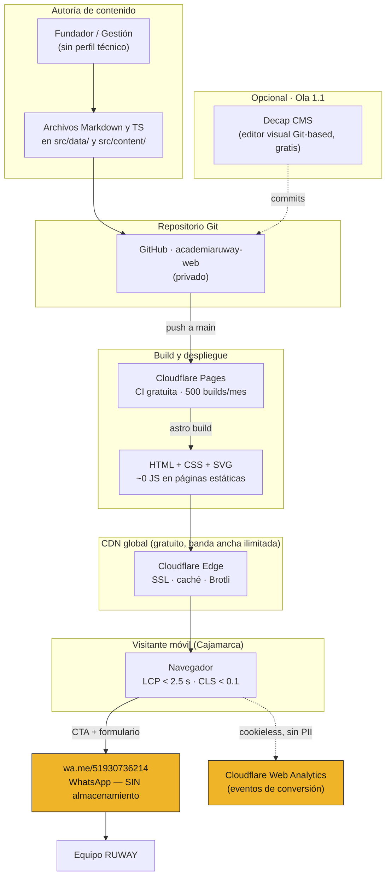

# 02 · Arquitectura Técnica y Stack — RUWAY ACADEMY

**Agente:** A2 (Arquitecto Técnico) · Fase 2
**Fecha:** 16 de octubre de 2026
**Entradas:** `01-sitemap-final.md` (aprobado) · `00-inventario-insumos.md` · `ruway-marca/*`

---

## 0. Restricciones que condicionan toda la decisión

| Restricción | Origen | Implicación técnica |
| :--- | :--- | :--- |
| **Presupuesto: S/ 180/año** para dominio + hosting | `plan completo.md §7.4` | Hosting **gratuito** obligatorio |
| **Sitio en vivo antes del 27/10/2026** | Fecha de inicio del Ciclo 1 | ~11 días: cero experimentos, cero dependencias frágiles |
| **13 páginas, mayormente estáticas** | Sitemap Ola 1 | No necesita base de datos ni SSR dinámico |
| **Tráfico móvil desde TikTok/Instagram/WhatsApp** | `plan §11.1` | LCP móvil crítico; peso mínimo |
| **SEO local fuerte** (Google Business) | `plan §11.1` canal 1 | HTML estático indexable + JSON-LD |
| **WCAG 2.2 AA desde el primer componente** | Brief, regla 5 | Componentes con semántica nativa |
| **Contenido editado por el fundador** (no dev) | `ruway-marca/AGENTS.md` | Edición simple |
| **Es un negocio, no un hobby** | — | Descartado: licencias no comerciales |

> 🔎 **Hallazgo relevante:** el plan pide un formulario **a WhatsApp sin backend** (§11.1 canal 6,
> mapa v1.0 §3.4). Esto no es una limitación: es la postura de **mínima exposición legal** frente a
> la Ley 29733, porque **no almacenamos datos** (y particularmente datos de menores). La decisión se
> refuerza en ADR-008.

---

## 1. Comparativa de stacks (4 opciones evaluadas)

### 1.1 Criterios y pesos

| Criterio | Peso | Por qué ese peso |
| :--- | --: | :--- |
| **Performance / Core Web Vitals** | 20 % | Tráfico móvil de redes: si carga lento, se pierde el lead |
| **SEO técnico** | 20 % | El canal #1 del plan es que te encuentren en Google |
| **Accesibilidad** | 15 % | Requisito de proyecto (WCAG 2.2 AA) + público escolar |
| **Costo total** | 20 % | Presupuesto de S/ 180/año |
| **Talento disponible en Perú** | 15 % | El proyecto debe poder mantenerse localmente |
| **Velocidad de entrega** | 10 % | Fecha límite: 27/10/2026 |

*Escala 1–5 (5 = mejor).*

### 1.2 Matriz de evaluación

| Criterio (peso) | **A · Astro + Tailwind**<br>Cloudflare Pages | **B · Next.js 15**<br>Vercel | **C · SvelteKit**<br>Cloudflare Pages | **D · WordPress**<br>Hosting compartido |
| :--- | :---: | :---: | :---: | :---: |
| Performance / CWV (20 %) | **5** | 4 | **5** | 2 |
| SEO técnico (20 %) | **5** | 4 | 4 | 3 |
| Accesibilidad (15 %) | **5** | 4 | 4 | 3 |
| Costo total (20 %) | **5** | 3 | **5** | 3 |
| Talento en Perú (15 %) | 3 | **5** | 2 | **5** |
| Velocidad de entrega (10 %) | **5** | 4 | 4 | 3 |
| **PUNTAJE PONDERADO** | **🏆 4.70** | 3.95 | 4.10 | 3.10 |

### 1.3 Notas críticas de cada opción

**A · Astro 5 + Tailwind CSS 4 + TypeScript · Cloudflare Pages — 4.70**
- **Zero JavaScript por defecto**: el HTML se sirve sin runtime; solo se hidrata lo indispensable.
  Es la razón directa por la que gana en CWV sobre Next.js.
- **Content Collections** para el temario, precios y FAQ → el fundador edita texto estructurado sin tocar componentes.
- **Tailwind CSS 4** consume la paleta de marca como design tokens nativos.
- **Cloudflare Pages**: tier gratuito con **ancho de banda ilimitado**, CDN global, SSL y
  **analítica sin cookies**. El presupuesto de S/ 180/año se convierte en ~S/ 45 (solo dominio).
- ⚠️ **Punto débil:** ecosistema React más pequeño → menos devs disponibles en Perú. Se mitiga
  con código comentado y componentes simples (§7).

**B · Next.js 15 (App Router) + Tailwind · Vercel — 3.95**
- La mejor opción si se sumara un desarrollador React. Ecosistema y talento enormes en Lima.
- **Pero:** el plan Hobby de Vercel **prohíbe uso comercial** → RUWAY tendría que pagar Pro
  (~USD 20/mes ≈ S/ 900/año), **5× el presupuesto anual completo**. Con un hosting gratuito
  alternativo, la comparación se vuelve incómoda por la configuración extra.
- Envía más JavaScript por defecto → exige trabajo adicional para llegar a LCP < 2.5 s en móvil gama media.

**C · SvelteKit + Tailwind (adapter-static) · Cloudflare Pages — 4.10**
- Técnicamente excelente, bundles mínimos, muy buen CWV.
- **Descartada por Talento (2/5):** es el framework con menos profesionales disponibles en Perú
  hoy. Un sitio que nadie local puede mantener es una deuda.

**D · WordPress + tema ligero — 3.10**
- **Talento 5/5**: cualquier freelancer peruano sabe WordPress.
- **Descartada por:** hosting de pago (no existe tier gratuito con dominio propio y buen
  rendimiento), mantenimiento de seguridad permanente (un sitio de una academia no debería ser
  una superficie de ataque), plugins que degradan CWV, y control de accesibilidad dependiente del tema.
- El fundador no es perfil técnico: mantener plugins y actualizaciones es carga, no solución.

---

## 2. Decisión final

> ### 🏆 Stack elegido: **Astro 5 + TypeScript + Tailwind CSS 4**, desplegado en **Cloudflare Pages**
>
> **Sin backend. Sin base de datos. Sin CMS en v1.** Contenido en Markdown/TypeScript dentro del repositorio.

**Por qué gana:** es el único stack que gana simultáneamente en **rendimiento**, **SEO**,
**accesibilidad** y **costo**, y que además se puede entregar en 11 días. La única categoría donde
no es primero es talento local — y en un sitio de 13 páginas estáticas eso se resuelve con
documentación, no con contrataciones.

**Alternativa recomendada si en 12 meses se contrata un dev React:** migrar a **Next.js 15**
(ver ADR-006, sección «Reevaluación»).

---

## 3. Diagrama de arquitectura



**Lectura del diagrama:**

| Capa | Tecnología | Costo |
| :--- | :--- | :--- |
| **Frontend** | Astro 5 + Tailwind 4 + TypeScript | S/ 0 |
| **Contenido** | Markdown/TS en el repo (Content Collections) | S/ 0 |
| **Backend** | ❌ **No existe** — el formulario compone un mensaje de WhatsApp | S/ 0 |
| **Base de datos** | ❌ **No existe** — cero datos personales almacenados | S/ 0 |
| **CMS** | ❌ No en v1 · opcional Decap CMS en Ola 1.1 | S/ 0 |
| **CDN / Hosting** | Cloudflare Pages (banda ancha ilimitada) | S/ 0 |
| **Analítica** | Cloudflare Web Analytics (sin cookies, sin PII) | S/ 0 |
| **Dominio** | `academiaruway.com` | ~S/ 45/año |
| | **TOTAL** | **~S/ 45/año** (presupuesto: S/ 180) |

> 💰 **Ahorro: ~S/ 135/año** respecto al presupuesto del plan. Queda margen para el dominio
> en `.com` y para renovaciones.

---

## 4. Estructura de carpetas del proyecto

```
ruway-web/
├── astro.config.mjs            # integraciones: sitemap, tailwind
├── package.json
├── tsconfig.json
├── .github/
│   └── workflows/
│       └── a11y.yml            # axe-core + Lighthouse CI en cada push
├── public/
│   ├── favicon.svg             # ← ruway-identidad/08-iconos-app-y-favicon/
│   ├── favicon-16/32/48/180/192/512.png
│   ├── ruway-icono-app-1024.png
│   ├── robots.txt
│   ├── logos/                  # copiados de ruway-identidad/ (SVG primero)
│   └── og/                     # imágenes Open Graph 1200×630
├── src/
│   ├── styles/
│   │   ├── tokens.css          # ⭐ design tokens de ruway-identidad
│   │   └── global.css          # reset, tipografía, utilidades base
│   ├── layouts/
│   │   └── BaseLayout.astro    # <head>, SkipLink, Header, Footer, landmarks
│   ├── components/
│   │   ├── SkipLink.astro
│   │   ├── Header.astro        # nav + menú móvil accesible
│   │   ├── Footer.astro        # 4 columnas + barra legal
│   │   ├── BotonCTA.astro      # botón/enlace de conversión
│   │   ├── CTAWhatsApp.astro   # enlace wa.me con mensaje prefijado
│   │   ├── Seo.astro           # metadata + JSON-LD por página
│   │   ├── Acordeon.astro      # <details>/<summary> accesible (FAQ)
│   │   ├── Tarjeta.astro
│   │   ├── Insignia.astro      # niveles 1–3 (activos de marca)
│   │   ├── BarraDatos.astro
│   │   └── AvisoCertificado.astro
│   ├── data/
│   │   ├── site.ts             # WhatsApp, correo, dominio, dirección, fecha inicio
│   │   ├── programa.ts         # ficha + 8 semanas + metodología + evaluación
│   │   ├── precios.ts          # tabla única + descuentos + devoluciones
│   │   ├── requisitos.ts
│   │   ├── faq.ts              # las 12 preguntas
│   │   └── perfiles.ts         # 3 segmentos de público
│   ├── lib/
│   │   ├── whatsapp.ts         # genera la URL de wa.me con el mensaje
│   │   └── formato.ts          # formato de precios (S/ 550)
│   └── pages/
│       ├── index.astro
│       ├── programa.astro
│       ├── precios.astro
│       ├── inscripcion.astro
│       ├── gracias.astro
│       ├── preguntas-frecuentes.astro
│       ├── sobre.astro
│       ├── contacto.astro
│       ├── instituciones.astro
│       ├── privacidad.astro
│       ├── terminos.astro
│       ├── cookies.astro
│       └── 404.astro
└── tests/
    └── a11y.spec.ts            # axe-core sobre las 13 páginas
```

**Convención de código:** componentes y variables en **español** (`BotonCTA`, `precios.ts`),
atributos HTML en inglés (estándar del navegador). Coherente con el idioma único del proyecto.

---

## 5. Estrategia de accesibilidad (WCAG 2.2 AA)

### 5.1 Herramientas y momentos de control

| Momento | Herramienta | Qué verifica |
| :--- | :--- | :--- |
| Durante el desarrollo | **axe DevTools** (extensión) | Violaciones automáticas en el navegador |
| En cada corrida · **3.6** | **`npm run auditar-a11y`** — axe-core por CDP sobre las **13 páginas** × 2 temas × 2 tamaños | Regresión: ninguna violación nueva |
| En cada corrida · **3.6** | **`npm run auditar-rendimiento`** — Lighthouse | Las 4 categorías ≥ 95 y los presupuestos del §6.4 |
| Antes de cada release | **WAVE** + **Lighthouse** manual | Revisión semántica |
| Antes de cada release · **3.6** | **`npm run auditar-a11y`** — 531 paradas de teclado | Orden de foco, foco visible, foco no oscurecido (2.4.11), sin trampas |
| Antes del lanzamiento | **NVDA** (Windows) + **VoiceOver** | Lectura real con lector de pantalla |
| Manual, 1 vez | Zoom **real** al 200 % en el navegador | Redimensionado (1.4.4). El ancho de 320 px (1.4.10) ya lo cubre la auditoría |

> **Lo que se construyó en el 3.6 no es lo que decía esta tabla, y conviene saberlo.** El plan nombraba
> `@axe-core/playwright` y Lighthouse CI; lo que hay son `scripts/auditar-accesibilidad.mjs` (axe-core
> sobre el protocolo de herramientas de desarrollo, sin Playwright) y `scripts/auditar-rendimiento.mjs`
> (la API de Node de Lighthouse). Miden lo mismo, no añaden un framework de pruebas al proyecto y están
> escritos para poder colgarse de un flujo de integración cuando exista repositorio. Los resultados y lo
> que queda en manos de una persona están en **`accessibility-report.md`**.

### 5.2 Reglas de diseño derivadas de la paleta (de la Fase 0)

| # | Regla | Criterio WCAG |
| --: | :--- | :--- |
| 1 | Maíz **nunca** como texto sobre Cal (1.6:1). Sí sobre Piedra (9.6:1) | 1.4.3 |
| 2 | Botón Maíz → **texto Piedra** | 1.4.3 |
| 3 | Niebla solo como borde/placeholder; nunca texto sobre Cal (2.3:1) | 1.4.3 / 1.4.11 |
| 4 | Ichu sobre Piedra (2.8:1) prohibido → definir variante clara `[POR APROBAR]` | 1.4.3 |
| 5 | **Anillo de foco doble**: Piedra en tema claro, Maíz en tema oscuro | 2.4.11 / 2.4.13 |
| 6 | `scroll-margin-top` en todo encabezado con `id` | 2.4.11 |
| 7 | Aviso del certificado siempre con **texto real**, no solo color o icono | 1.4.1 / 1.4.5 |

### 5.3 Checklist WCAG 2.2 AA aplicado al sitio

**Perceptible (1.x)**

| Criterio | Nivel | Cómo se cumple |
| :--- | :---: | :--- |
| 1.1.1 Contenido no textual | A | `alt` en imágenes; logos SVG con `<title>` y `role="img"`; decorativos con `alt=""` |
| 1.3.1 Información y relaciones | A | HTML semántico; tablas de precios con `<th scope>`; campos con `<label for>` |
| 1.3.2 Secuencia significativa | A | Orden del DOM = orden visual |
| 1.3.3 Características sensoriales | A | Nunca "haz clic en el botón amarillo" |
| 1.3.4 Orientación | AA | Sin bloqueo de vertical/horizontal |
| 1.3.5 Identificar el propósito | AA | `autocomplete` en nombre, correo y teléfono |
| 1.4.1 Uso del color | A | El estado de error lleva texto + icono, no solo rojo |
| 1.4.3 Contraste (mínimo) | AA | Ver reglas §5.2 (base 15.9:1) |
| 1.4.4 Redimensionar texto | AA | Unidades `rem`; verificado al 200 % |
| 1.4.5 Imágenes de texto | AA | **Cero texto en imágenes**; el logo es SVG con texto real alternativo |
| 1.4.10 Reflow | AA | Funciona a 320 px sin scroll horizontal |
| 1.4.11 Contraste no textual | AA | Bordes de inputs y anillo de foco ≥ 3:1 |
| 1.4.12 Espaciado del texto | AA | Sin alturas fijas que rompan el espaciado |
| 1.4.13 Contenido en hover/focus | AA | Tooltips descartables, hoverables, persistentes |

**Operable (2.x)**

| Criterio | Nivel | Cómo se cumple |
| :--- | :---: | :--- |
| 2.1.1 Teclado | A | Todo accesible con Tab; acordeón FAQ con `<details>` nativo |
| 2.1.2 Sin trampa de teclado | A | El menú móvil permite salir con Esc |
| 2.2.2 Pausar, detener, ocultar | A | Animaciones no esenciales se pueden pausar |
| 2.3.1 Sin destellos | A | Sin flashes > 3/segundo |
| 2.4.1 Evitar bloques | A | **Skip link** "Saltar al contenido principal" |
| 2.4.2 Título de página | A | Título único por página |
| 2.4.3 Orden del foco | A | Orden lógico del DOM |
| 2.4.4 Propósito del enlace | A | Texto descriptivo ("Ver el temario completo", no "clic aquí") |
| 2.4.5 Múltiples vías | AA | Header + footer + enlaces contextuales + `sitemap.xml` |
| 2.4.6 Encabezados y etiquetas | AA | Un solo `<h1>` por página; jerarquía sin saltos |
| 2.4.7 Foco visible | AA | Anillo doble siempre visible (§5.2 regla 5) |
| **2.4.11 Foco no oscurecido** | **AA (2.2)** | Header fijo + `scroll-margin-top` |
| 2.5.1 Gestos de puntero | A | Sin gestos multipunto obligatorios |
| 2.5.2 Cancelación del puntero | A | Acciones en `click`/`mouseup`, no en `mousedown` |
| 2.5.3 Etiqueta en el nombre | A | Texto visible contenido en el nombre accesible del CTA |
| 2.5.4 Activación por movimiento | A | Sin interacción por agitado/inclinación |
| **2.5.7 Movimientos de arrastre** | **AA (2.2)** | Ningún control requiere arrastrar |
| **2.5.8 Tamaño del objetivo** | **AA (2.2)** | Todos los controles ≥ 24×24 px (objetivo: 44×44 en CTAs) |

**Comprensible (3.x)**

| Criterio | Nivel | Cómo se cumple |
| :--- | :---: | :--- |
| 3.1.1 Idioma de la página | A | `<html lang="es-PE">` |
| 3.2.1 En foco | A | Ningún cambio de contexto al recibir foco |
| 3.2.2 En la entrada | A | Sin envíos automáticos al cambiar un campo |
| 3.2.3 Navegación coherente | AA | Mismo header/footer en todas las páginas |
| 3.2.4 Identificación coherente | AA | Mismos iconos y nombres en todo el sitio |
| **3.2.6 Ayuda coherente** | **A (2.2)** | WhatsApp y contacto en la **misma posición relativa** en todas las páginas |
| 3.3.1 Identificación de errores | A | Error en texto junto al campo |
| 3.3.2 Etiquetas o instrucciones | A | Campos etiquetados; requisitos explicados antes del formulario |
| 3.3.3 Sugerencia ante errores | AA | "Escribe tu número de 9 dígitos, ej. 930 736 214" |
| 3.3.4 Prevención de errores | AA | Revisión del mensaje antes de enviar a WhatsApp |
| **3.3.7 Entrada redundante** | **A (2.2)** | Los datos se escriben una sola vez |
| **3.3.8 Autenticación accesible** | **AA (2.2)** | No aplica al público: no hay login |

**Robusto (4.x)**

| Criterio | Nivel | Cómo se cumple |
| :--- | :---: | :--- |
| 4.1.2 Nombre, función, valor | A | ARIA solo cuando el HTML nativo no alcanza |
| 4.1.3 Mensajes de estado | AA | Región `aria-live` para la confirmación del formulario |

**Explícitamente fuera de alcance (nivel AAA):** 2.4.12 *Foco no oscurecido (mejorado)* y
2.4.13 *Apariencia del foco*. Se aplican buenas prácticas, pero no se certifican.

### 5.4 Movimiento y `prefers-reduced-motion`

Todo motion (trazo del logo que se dibuja, aparición de secciones) se implementa **dentro** de:

```css
@media (prefers-reduced-motion: no-preference) { /* animaciones */ }
```

Es decir: **la animación es la mejora, no el estado por defecto**. Con `reduced-motion` activo,
el contenido aparece ya visible, sin transiciones. Ninguna información depende del movimiento.

---

## 6. Estrategia de SEO

### 6.1 Técnico

| Elemento | Implementación |
| :--- | :--- |
| Renderizado | **HTML estático** (Astro) → indexable sin ejecutar JS |
| Títulos | Patrón: `{Página} · Curso de Inteligencia Artificial en Cajamarca \| RUWAY ACADEMY` |
| `meta description` | Única por página, 140–160 caracteres, orientada a beneficio |
| `canonical` | Absoluta en todas las páginas → `https://academiaruway.com/...` |
| `sitemap.xml` | Generado por `@astrojs/sitemap` (automático en build) |
| `robots.txt` | Permite todo excepto `/gracias`; declara el sitemap |
| `lang` | `es-PE` |
| OG / Twitter Cards | Imagen 1200×630 por página, con el logo descriptor sobre fondo de marca |
| `noindex` | `/gracias` y `/404` |
| Enlazado interno | Cada página enlaza al siguiente paso del embudo (refuerza contexto temático) |

### 6.2 Schema.org (JSON-LD)

| Tipo | Dónde | Campos clave |
| :--- | :--- | :--- |
| `EducationalOrganization` | Global | `name`, `url`, `email`, `telephone`, `address` |
| `LocalBusiness` | `/contacto`, `/sobre` | `address` (Jr. Los Geranios 250, Cajamarca), `geo` `[POR DEFINIR]`, `openingHours` `[POR DEFINIR]`, `areaServed` "Cajamarca" |
| `Course` + `CourseInstance` + `Offer` | `/programa`, `/precios` | `name` "Programa de Inteligencia Artificial Aplicada", `timeRequired` `P8W`, `startDate` `2026-10-27`, `maximumAttendeeCapacity` 10, `offers` S/ 550 y S/ 450 con `priceCurrency: PEN` |
| `FAQPage` | `/preguntas-frecuentes` | Las 12 preguntas reales (elegibles para resultados enriquecidos) |
| `BreadcrumbList` | Páginas internas | Migas de pan |
| `Event` | `/demo-day` (Ola 2) | Demo Day público |

> ⚠️ **Nunca** declarar `educationalCredentialAwarded` que insinúe reconocimiento oficial.
> El certificado **no tiene validez oficial MINEDU** (§5.7 del plan). La honestidad también es SEO:
> evita expectativas que generen rebote y reseñas negativas.

### 6.3 SEO local (canal #1 del plan)

- **NAP consistente** en `/contacto`, `/sobre` y el footer: *RUWAY ACADEMIA · Jr. Los Geranios 250,
  Cajamarca · +51 930 736 214* — idéntico a la ficha de Google Business Profile.
- Página `/contacto` con **dirección textual + mapa embebido accesible** (iframe con `title`).
- Palabras clave locales integradas naturalmente: *"curso de inteligencia artificial en Cajamarca"*,
  *"academia de IA Cajamarca"*.
- Sin keyword stuffing: la densidad la fija el copy real de `plan completo.md`.

### 6.4 Rendimiento medible (presupuestos)

| Métrica | Objetivo | Decisión técnica que lo habilita |
| :--- | :--- | :--- |
| **LCP** | < 2.5 s (móvil 4G) | HTML estático, sin JS bloqueante, fuentes self-hosted con `font-display: swap` y precarga |
| **INP** | < 200 ms | Casi cero JS; el formulario es HTML nativo |
| **CLS** | < 0.1 | Dimensiones explícitas en imágenes y logos; sin contenido inyectado |
| **Lighthouse** | ≥ 95 en las 4 categorías | Tailwind purgado, SVG en lugar de PNG, imágenes en AVIF/WebP |
| **Peso de página** | < 150 KB (HTML+CSS) sin imágenes | Sin librerías de UI, sin framework JS |
| **Fuentes** | 2 familias + 1 mono, subset latino | Bricolage Grotesque + Instrument Sans + JetBrains Mono, solo pesos usados |

---

## 7. Mitigación del riesgo «talento local en Astro»

Astro es el punto débil en disponibilidad de desarrolladores en Perú. Se mitiga así:

1. **Cero abstracciones propias:** componentes Astro simples, sin librería de estado ni lógica compleja.
2. **Contenido separado del código:** todo el texto vive en `src/data/*.ts` → se edita sin entender el framework.
3. **README de mantenimiento** con: cómo cambiar un precio, cómo publicar, cómo añadir una FAQ.
4. **Sin dependencias exóticas:** Astro + Tailwind + sitemap. Nada más.
5. **Salida estándar:** al generar HTML/CSS plano, cualquier dev de cualquier stack puede intervenir.

---

## 8. Decisiones registradas

Ver `decisions.md`: **ADR-006** (stack Astro), **ADR-007** (Cloudflare Pages), **ADR-008**
(sin backend: WhatsApp), **ADR-009** (sin CMS en v1), **ADR-010** (analítica sin cookies).

---

## 9. Plan de implementación de la Fase 3

| Incremento | Contenido | Checkpoint |
| :--- | :--- | :--- |
| **3.1 Setup** | Repo, Astro + TS + Tailwind, design tokens, `03-sistema-diseno.md` | `$approve-3.1` |
| **3.2 Layout base** | Skip link, Header, Footer, landmarks ARIA, `BaseLayout` | `$approve-3.2` |
| **3.3 Home** | Los 11 bloques de la Home (§5 del sitemap) | `$approve-3.3` |
| **3.4 Páginas internas** | Programa, Precios, Sobre, FAQ, Contacto, Instituciones | `$approve-3.4` |
| **3.5 Formulario** | Inscripción accesible + composición del mensaje de WhatsApp | `$approve-3.5` |
| **3.6 Optimización** | Lighthouse ≥ 95, axe sin violaciones, `accessibility-report.md` | `$approve-3.6` |

---

**Checkpoint 2 — Comandos:** `$approve-2` · `$revise-2 "feedback"`

> ⚠️ **Regla del pipeline:** no se escribe código hasta que este stack quede aprobado.
